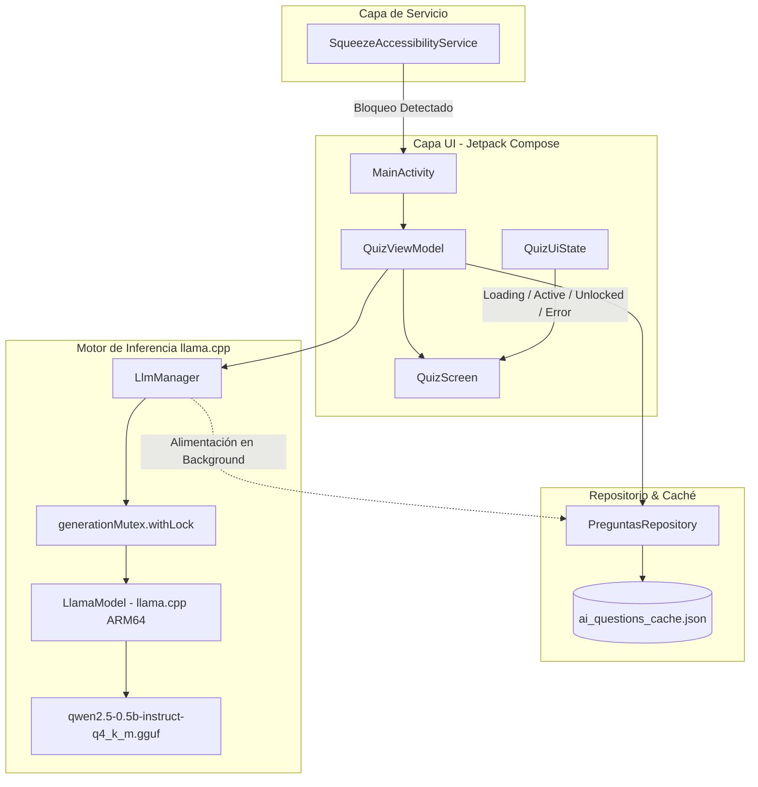

# AppSqueeze - On-Device LLM App Blocker for Android

[](https://android.com)
[](https://kotlinlang.org)
[-purple.svg)](https://developer.android.com/jetpack/compose)
[-orange.svg)](https://github.com/ggml-org/llama.cpp)
[](https://huggingface.co/Qwen/Qwen2.5-0.5B-Instruct-GGUF)

**AppSqueeze** es un bloqueador de aplicaciones y pantalla de estudio para Android impulsado **100% por Inteligencia Artificial local On-Device**. Utiliza un `AccessibilityService` para interceptar cuando el usuario intenta abrir apps distractoras o salir al launcher, forzándolo a responder correctamente 3 preguntas técnicas de entrevistas de software generadas en tiempo real y de forma completamente offline por un modelo LLM (**Qwen 2.5 0.5B Instruct**) mediante **llama.cpp**.

---

## Características Principales

- **Bloqueo Inteligente de Pantalla:** Intercepta cambios de ventana (`typeWindowStateChanged`) y previene la evasión de la pantalla mediante `BackHandler` y permisos de sobreposición (`SYSTEM_ALERT_WINDOW`).
- **Inferencia 100% Local y Offline (Zero Cloud):** Todo el procesamiento de lenguaje natural se realiza directamente en la CPU del dispositivo usando cuantización de 4 bits (`Q4_K_M`), garantizando máxima privacidad sin consumo de datos móviles ni latencia de red.
- **Banco Dinámico de Preguntas Técnicas:** Preguntas de opción múltiple de nivel entrevista técnica en áreas clave:
  - Bases de Datos Relacionales (SQL, Índices, Transacciones ACID, PostgreSQL)
  - Backend y APIs (REST, Códigos de Estado HTTP, JWT, Middleware)
  - Kotlin Avanzado (Coroutines, Flow, Dispatchers, Inmutabilidad)
  - Arquitectura de Software (Clean Architecture, SOLID, Inyección de Dependencias, MVVM)
  - Git y DevOps (Rebase vs Merge, Docker básico, CI/CD)
  - Manejo de Memoria y Optimización (Leaks, Garbage Collection, Caché)
- **Barajado Aleatorio y Deduplicación:** La opción correcta se distribuye al azar entre A, B, C y D (`shuffled()`), y un registro histórico de enunciados recientes previene preguntas repetidas.
- **Caché en Segundo Plano:** El motor de IA genera y almacena preguntas periódicamente en la caché local (`ai_questions_cache.json`) para que la pantalla de bloqueo responda al instante (0 ms).

---

## Arquitectura y Concurrencia

El proyecto sigue una arquitectura **MVI / MVVM reactiva** construida sobre Jetpack Compose y Kotlin Coroutines:



### Control de Concurrencia con `Mutex`
Dado que el contexto de decodificación en C++ de `llama.cpp` es secuencial por diseño, `LlmManager` utiliza un `Mutex` (`kotlinx.coroutines.sync.Mutex`) para sincronizar de forma atómica las peticiones on-demand de la UI y la precarga del generador en segundo plano, evitando colisiones de tipo `Generation already in progress`.

---

## Tech Stack

| Componente | Tecnología |
| :--- | :--- |
| **Lenguaje** | Kotlin 2.2.10 |
| **Interfaz de Usuario** | Jetpack Compose + Material 3 |
| **Gestión de Estado** | StateFlow, ViewModel (`QuizUiState`) |
| **Motor LLM Local** | llama.cpp mediante `org.codeshipping:llama-kotlin-android:0.1.3` |
| **Modelo de Lenguaje** | Qwen 2.5 0.5B Instruct GGUF (`qwen2.5-0.5b-instruct-q4_k_m.gguf` ~491 MB) |
| **Formato de Prompt** | ChatML Few-Shot con prefill de asistente |
| **Servicio de Bloqueo** | Android `AccessibilityService` |
| **Concurrencia** | Kotlin Coroutines (`Dispatchers.IO.limitedParallelism(1)` + `Mutex`) |

---

## Hardware y Rendimiento de Referencia

Las pruebas de estrés, inferencia local y gestión de memoria se ejecutaron bajo un perfil de hardware representativo:

- **Hardware de Referencia:** SoC ARM64 Octa-Core (MediaTek Helio G90T o equivalente / Snapdragon serie 700).
- **Memoria RAM:** 6 GB LPDDR4X.
- **Sistema Operativo:** Android 11+ (Probado en MIUI / Android Stock).
- **Rendimiento:** ~7.3s por generación completa sin saturación de memoria.
- **Consumo de Memoria:** Estable por debajo de ~1.1 GB totales de proceso (0 cierres por Out-Of-Memory).
- **Paralelismo de Inferencia:** 4 hilos en CPU con cuantización `Q4_K_M` en llama.cpp.

---

## Guía de Configuración Local

Debido a las políticas de tamaño de Git y GitHub, el archivo binario del modelo GGUF (~491 MB) no está versionado en este repositorio.

### Paso 1: Clonar el Repositorio
```bash
git clone https://github.com/TU_USUARIO/AppSqueeze.git
cd AppSqueeze
```

### Paso 2: Descargar el Modelo Qwen GGUF
Descarga el modelo oficial cuantizado en 4 bits desde el repositorio de **Qwen en Hugging Face**:

- **Modelo:** `Qwen2.5-0.5B-Instruct-GGUF`
- **Archivo:** `qwen2.5-0.5b-instruct-q4_k_m.gguf` (~491 MB)
- **Enlace de Descarga:** [Hugging Face - qwen2.5-0.5b-instruct-q4_k_m.gguf](https://huggingface.co/Qwen/Qwen2.5-0.5B-Instruct-GGUF/blob/main/qwen2.5-0.5b-instruct-q4_k_m.gguf)

### Paso 3: Ubicar el Modelo en el Proyecto
Coloca el archivo descargado en la carpeta de assets de la aplicación:
```text
app/src/main/assets/qwen2.5-0.5b-instruct-q4_k_m.gguf
```

> [!TIP]
> **Optimización para pruebas rápidas vía ADB:**
> Para no inflar el tamaño del APK de desarrollo, puedes transferir el modelo directamente al almacenamiento del teléfono una sola vez:
> ```bash
> adb push qwen2.5-0.5b-instruct-q4_k_m.gguf /sdcard/Download/qwen2.5-0.5b-instruct-q4_k_m.gguf
> ```
> La app detecta automáticamente si el modelo ya está presente en `/sdcard/Download/` o en `filesDir` y lo utiliza directamente sin duplicarlo.

### Paso 4: Compilar e Instalar
```powershell
.\gradlew.bat assembleDebug
adb install -r app/build/outputs/apk/debug/app-debug.apk
```

---

## Permisos Requeridos en el Dispositivo

Para garantizar que AppSqueeze pueda detectar aperturas de aplicaciones y desplegar la pantalla de evaluación de forma ininterrumpida, se requieren los siguientes permisos del sistema:

1. **Permiso de Accesibilidad:** `Ajustes > Accesibilidad > Servicios descargados > Activar AppSqueeze`. Permite al servicio detectar ventanas activas (`typeWindowStateChanged`) e interceptar la navegación.
2. **Permiso de Sobreposición (`SYSTEM_ALERT_WINDOW`):** Permite mostrar el cuestionario flotante sobre cualquier aplicación abierta.

---

### Configuración para Dispositivos con Capas Agresivas (Xiaomi / MIUI, Huawei, Samsung)

Los fabricantes con capas de personalización que gestionan la memoria y batería de manera agresiva requieren ajustes adicionales para evitar que el sistema detenga el servicio o bloquee el lanzamiento de actividades en primer plano.

#### NOTA ESPECIAL PARA DISPOSITIVOS XIAOMI / MIUI:
En dispositivos Xiaomi, la capa MIUI restringe por defecto que los servicios en segundo plano muestren ventanas o pantallas completas. Por ello, es **OBLIGATORIO** ir a **Ajustes de la App > Otros permisos** y marcar con **check verde**:

* **"Mostrar ventanas emergentes mientras se ejecuta en segundo plano":** Indispensable para que el `AccessibilityService` pueda desplegar el cuestionario al detectar una aplicación bloqueada.
* **"Mostrar en pantalla de bloqueo":** Permite desplegar el cuestionario incluso si el dispositivo se encuentra bloqueado o recién encendido.
* **"Mostrar ventanas emergentes":** Permitido.

Adicionalmente, en la configuración de la aplicación:
* Configurar **"Ahorro de batería"** en **"Sin restricciones"** (evita que el optimizador del sistema elimine el proceso de inferencia de 491 MB en segundo plano).
* Configurar **"Inicio automático"** en **activado** (asegura la continuidad del servicio tras reiniciar el sistema).

#### Dispositivos Huawei (EMUI) y Samsung (One UI):
* **Huawei:** En *Ajustes > Batería > Inicio de aplicaciones*, buscar AppSqueeze y configurar en *Gestionar manualmente* (activando Inicio automático, Inicio secundario y Ejecutar en segundo plano).
* **Samsung:** En *Ajustes > Cuidado del dispositivo > Batería > Límites de uso en segundo plano*, agregar AppSqueeze a *Aplicaciones que nunca se suspenden*.

---

## Licencia

Este proyecto está distribuido bajo la licencia MIT. Consulta el archivo `LICENSE` para más detalles.
